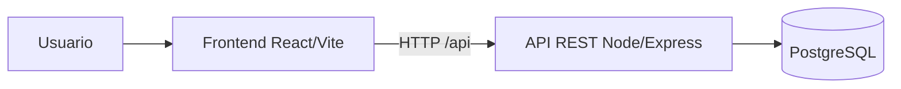

# Arquitectura

## Decisiones
| Decisión | Motivo |
|---|---|
| Node/Express + React | Un solo lenguaje, rápido de probar en CI |
| Repositorio de datos intercambiable (`repo.js`) | Pruebas unitarias con memoria; integración con PostgreSQL en GitHub Actions |
| Reglas de negocio en `domain.js` | Transiciones de estado y dashboard testeables sin I/O |
| Bitácora en tabla separada | Historial por incidente (comentarios + eventos de sistema) |

## Modelo de datos
`incidents(id, titulo, descripcion, categoria, prioridad, usuario, fecha, estado, tecnico)` y `bitacora(id, incident_id, autor, texto, tipo, fecha)`. Ver `database/schema.sql`.

## Transiciones de estado
NUEVO→ASIGNADO→EN_PROCESO→RESUELTO→CERRADO; RESUELTO→EN_PROCESO (reapertura). Asignar un técnico a un incidente NUEVO lo pasa a ASIGNADO.
